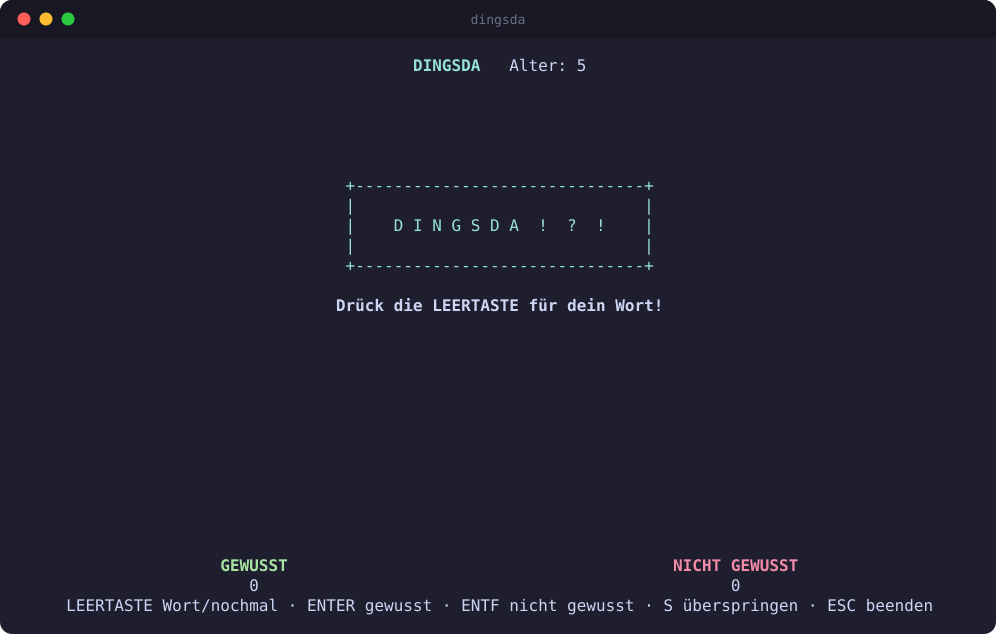
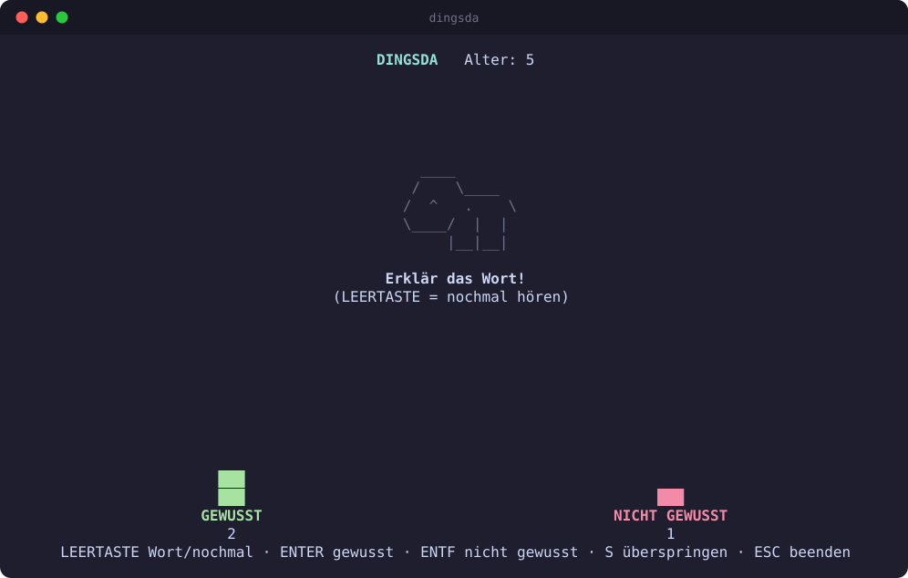
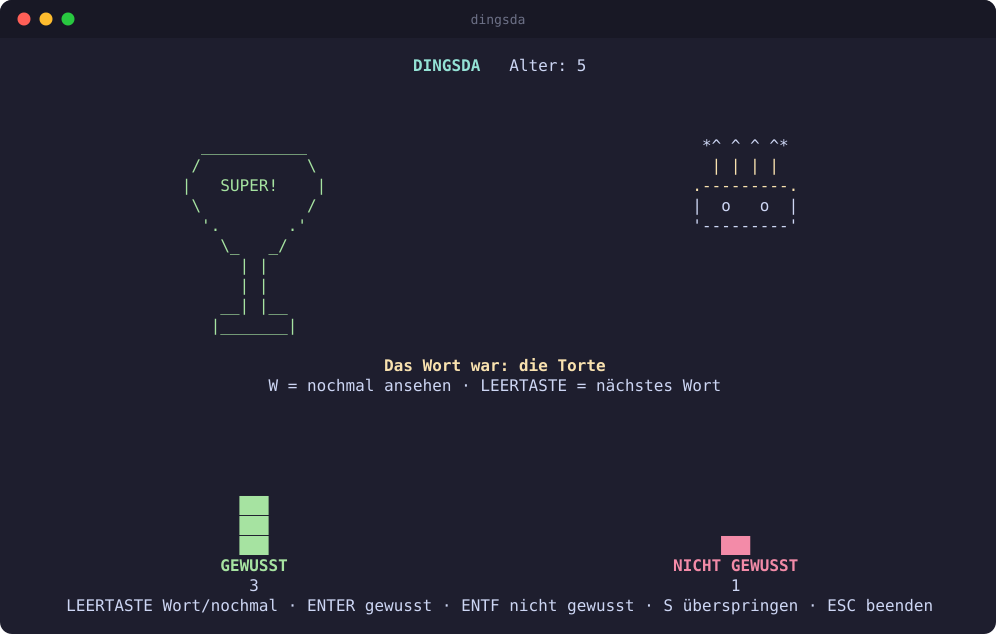
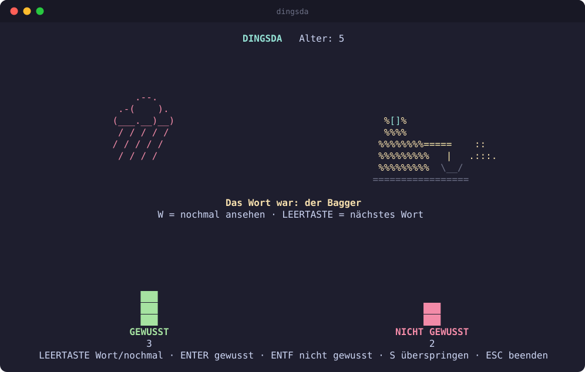
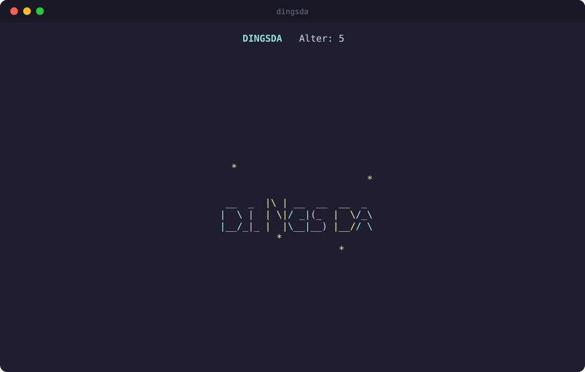
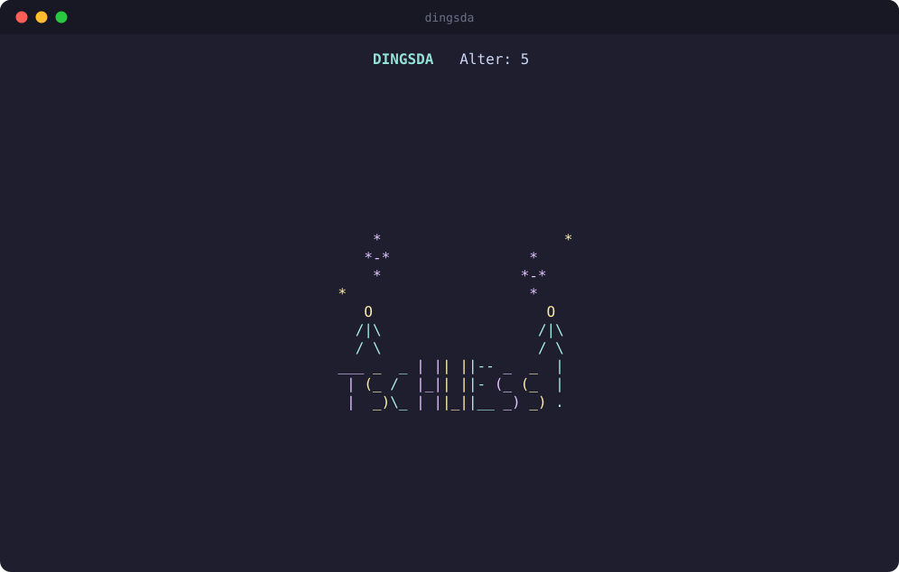

<div align="center">

```
  __  _  |\ | __  __  __  _
 |  \ |  | \|/ _|(_  |  \/_\
 |__/_|_ |  |\__|__) |__// \
```

# D I N G S D A &nbsp;!&nbsp;?&nbsp;!

**The word-explaining party game for small children (3–6 years), played in the terminal.**

<sub>Inspired by the German TV show "Dingsda" · German words · offline · no screen spoilers</sub>

[](https://nodejs.org)
[](https://www.typescriptlang.org)
[](LICENSE)
[](#words)
[](#ascii-movies)
[](#technology--runtime)



</div>

---

## The idea

The child hears a **secret word through headphones** and explains it without saying it.
The audience (the adults) tries to guess the word.
The words fit the child's age, are hard enough to be challenging to explain, and should be fun for both the child and the audience.

This app is an enabler to play this game. The child runs it alone, with one hand on a few big keys.

## A round at a glance

<table>
<tr>
<td width="50%" valign="top">

**1. Ready**<br>
The adult enters the age; the child takes over the keyboard and presses <kbd>Space</kbd>.



</td>
<td width="50%" valign="top">

**2. Explain**<br>
The word is spoken in the headphones only. A little coloured ASCII movie plays on screen to help the child.



</td>
</tr>
<tr>
<td width="50%" valign="top">

**3. Guessed!** <kbd>Enter</kbd><br>
Fun ASCII art, the word is revealed, the green column grows.



</td>
<td width="50%" valign="top">

**4. Not guessed** <kbd>Backspace</kbd><br>
A rain cloud, the reveal, and the red column grows. Then on to the next word.



</td>
</tr>
</table>

<details>
<summary><b>Intro and outro</b> (5 s each, any key skips them)</summary>
<br>

<table>
<tr>
<td width="50%"></td>
<td width="50%"></td>
</tr>
</table>

</details>

## How to play

The adult starts the program and enters the child's age (3, 4, 5 or 6; younger counts as 3, older as 6).
Then the child takes over the keyboard:

| Key | Action |
|---|---|
| `Space` | Hear a new word (via headphones). Press again to hear the same word again. |
| `Enter` | Success: the audience guessed it. Shows fun ASCII art and reveals the word. |
| `Del` / `Backspace` | Not guessed. Shows "fail" ASCII art and reveals the word. |
| `w` | Replay the word's ASCII movie and say the word again (after the reveal: "Film nochmal ansehen"). |
| `s` / `→` | Skip the word (e.g. child doesn't know it). Not counted, not revealed. |
| `Esc` | Asks "Wirklich beenden? (j/n)". `j` quits, `n` continues. |
| `Ctrl+C` | Quits immediately. |

The word is **never shown on screen** before the round ends. Only the child hears it.

Two columns, a green **GEWUSST** column and a red **NICHT GEWUSST** column, add up the results of the current session in ASCII-art style.

## ASCII movies

- When the word is spoken, a small coloured ASCII movie of it plays: 3 frames, one per second, then it stays on the last frame. `w` replays it. `Space` starts the next word and clears it. The movie starts when the word is spoken (and again each time the child repeats it), so it helps the child explain; `w` replays it after the reveal.
- A short intro (5 s) plays after the age is entered and an outro (5 s) before the goodbye screen. Any key skips them.
- Each of the 15 categories has a category movie. About 200 words have their own movie; every other word falls back to its category movie.
- Compact terminals (under 40 columns or 20 rows) show no movies.
- The art lives in plain-text files in `data/art/` (format: see `implementation_plan_feature_ascii_art.md`, section 1). Preview with `npx tsx scripts/preview-art.ts <word id|category slug|--all|--coverage> [--animate]`.
- To add a word movie, append it to `data/art/words/<category-slug>.txt` (id = the word's id, 3 frames, at most 10 lines × 32 columns, printable ASCII) and run `npm test`. Raise the minimum in `test/art.test.ts` when you add many.

## Words

- German only.
- A static, bundled list of about 1000 words in four age classes: 3, 4, 5 and 6 years (about 250 each).
- A child gets words from their own age class (about 70%) and from younger classes (about 30%).
- No word repeats within a session.
- The word is spoken with its article ("der Regenschirm").

## Technology & Runtime

- Runs on any Linux in a terminal; no graphical interface needed.
- TypeScript on Node.js ≥ 22.
- Speech: [Piper](https://github.com/rhasspy/piper), offline neural TTS, with the German voice `de_DE-thorsten-medium`.
  A one-time `dingsda setup` downloads Piper and the voice, then pre-renders all words to WAV files in `~/.local/share/dingsda/`.
- Audio playback uses `pw-play`, `paplay` or `aplay`, whichever is found first.
- **Headphones must be the default audio output**, so the adults can't hear the word. Check it with `dingsda --test-audio`.
- No LLM and no network access at game time.
- No persistence required.

## Quick start

```bash
npm install
npm run build
npx dingsda setup          # one time: download Piper + voice, render audio
npx dingsda --test-audio   # check that sound only comes out of the headphones
npx dingsda                # play
```

The screenshots in `docs/` are rendered from the real UI code. Regenerate them with `npx tsx scripts/make-screenshots.ts`.

During development, `npx tsx src/main.ts --silent --age 4` runs without sound and prints the word to stderr.

## Outlook (not implemented yet; the architecture keeps room for these)

- A database of seen words, so words don't repeat across sessions (a simple file is enough).
- More age classes (7+).
- Optional additional word sources (e.g. LLM-generated).

## License and credits

dingsda is released under the [MIT License](LICENSE).

Speech is generated by third-party software that is **not** included in this repository. `dingsda setup` downloads it from its original sources:

- [Piper](https://github.com/rhasspy/piper) (MIT), offline neural text-to-speech. Its release package bundles espeak-ng (GPL-3.0).
- The German voice `de_DE-thorsten-medium` from [rhasspy/piper-voices](https://huggingface.co/rhasspy/piper-voices), based on the Thorsten dataset by Thorsten Müller (CC0 1.0, public domain dedication).
